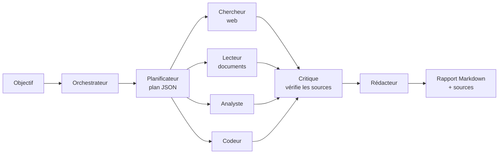

# Système multi-agents IA local

Assistant de **recherche, de veille et d'analyse de documents** qui tourne entièrement sur votre PC, avec [Ollama](https://ollama.com) et les modèles Qwen. Vous donnez un objectif en français, une équipe d'agents le découpe en étapes, lit vos documents, cherche sur le web, vérifie ses sources et vous rend un rapport structuré, avec une source pour chaque affirmation importante.

Code maison, sans framework d'agents. Coût : 0 € en local.

## Exemples d'objectifs

- « Fais une synthèse de ces cinq PDF avec les points clés. »
- « Fais une veille sur l'IA dans la santé ce mois-ci. »
- « Compare ces trois logiciels de comptabilité et recommande-m'en un. »
- « Que dit ce contrat sur la résiliation ? »

## Fonctionnement



| Agent | Rôle | Modèle |
|---|---|---|
| Planificateur | Découpe l'objectif en étapes | qwen3:14b |
| Chercheur | Recherche web et lecture de pages | qwen3:14b |
| Lecteur | PDF, Word, Excel et mémoire de documents | qwen3:14b |
| Analyste | Croise, compare, repère les contradictions | qwen3:14b |
| Codeur | Calculs et graphiques en bac à sable | qwen2.5-coder:7b |
| Critique | Vérifie les faits et les sources | qwen3:14b |
| Rédacteur | Rapport : synthèse, veille ou comparatif | qwen3:14b |

## Installation

Prérequis : Windows 10/11, Python 3.11 ou plus récent, [Ollama](https://ollama.com/download), environ 16 Go d'espace disque.

```powershell
ollama pull qwen3:14b
ollama pull qwen2.5-coder:7b
ollama pull nomic-embed-text

git clone <url-du-depot> multi-agents
cd multi-agents
python -m venv .venv
.venv\Scripts\Activate.ps1
pip install -r requirements.txt
copy .env.example .env
python scripts/check_env.py
```

## Utilisation

```powershell
# En ligne de commande
python main.py "Fais une synthèse de ce document" --files mon_document.pdf

# Indexer vos documents dans la mémoire long terme
python scripts/index_docs.py

# Interface web (API + interface, ouvre le navigateur)
.\start.ps1

# Évaluation chiffrée
python scripts/evaluate.py
```

## Structure du projet

```
agents/        registre des agents, prompts, gabarits de rapport, agents YAML (definitions/)
orchestrator/  plan, ordre des étapes, limites, plan de secours
llm/           connexion à Ollama (et à Claude en option)
tools/         calculatrice, fichiers, documents, web, mémoire, code
memory/        mémoire de la tâche et mémoire long terme (ChromaDB)
storage/       historique SQLite
security/      dossiers autorisés, validations, anti-injection
logging_/      journal JSONL de chaque appel
api/  ui/      API FastAPI et interface Streamlit
scripts/       vérification, indexation, évaluation, avis, veille programmée
tests/         tests pytest et jeu d'évaluation
docs/          cahier des charges, architecture, guides
```

## Avancement

| Phase | État |
|---|---|
| 0 à 3 — Installation, besoin, architecture, choix techniques | ✅ |
| 4 — Prototype (agents, orchestrateur, critique, rapport) | ✅ |
| 5 — Outils réels (web, documents, mémoire, code) | ✅ |
| 6 — Fiabilité et sécurité (limites, anti-injection, contrôle des chiffres) | ✅ |
| 7 — Évaluation chiffrée (30 tâches, `scripts/evaluate.py`) | ✅ outil prêt — mesure complète à faire avec Qwen |
| 8 — Version 1.0 (API FastAPI + interface Streamlit, `start.ps1`) | ✅ |
| 9 — Amélioration continue (parallélisme, avis 👍/👎, agents YAML, veille programmée, option Claude) | ✅ |

## Documentation

- [Cahier des charges](docs/cahier_des_charges.md)
- [Architecture](docs/architecture.md)
- [Fiches des agents](docs/agents.md)
- [Mémoire](docs/memoire.md)
- [Technologies](docs/stack.md)
- [Guide d'utilisation](docs/guide_utilisation.md)
